# EZ-ITAM Entity Relationship Diagram

ERD này phản ánh quan hệ được khai báo bởi EF Core migrations. `__EFMigrationsHistory` và các bảng Hangfire không có quan hệ nghiệp vụ nên không đưa vào sơ đồ. Khóa `Id` là PK; các nhãn trong quan hệ là FK.

```mermaid
erDiagram
    AssetCategories ||--o{ Assets : "CategoryId (RESTRICT)"
    Vendors o|--o{ Assets : "VendorId (SET NULL)"
    Locations o|--o{ Assets : "LocationId (SET NULL)"
    Employees o|--o{ Assets : "CurrentEmployeeId (SET NULL)"
    Assets ||--o{ AssetAssignments : "AssetId (CASCADE)"
    Employees ||--o{ AssetAssignments : "EmployeeId (RESTRICT)"
    Assets ||--o{ MaintenanceRecords : "AssetId (CASCADE)"
    Vendors o|--o{ MaintenanceRecords : "VendorId (SET NULL)"
    Vendors o|--o{ SoftwareLicenses : "VendorId (SET NULL)"
    SoftwareLicenses ||--o{ LicenseAssignments : "SoftwareLicenseId (CASCADE)"
    Assets o|--o{ LicenseAssignments : "AssetId (CASCADE)"
    Employees o|--o{ LicenseAssignments : "EmployeeId (CASCADE)"
    Departments o|--o{ Employees : "DepartmentId (SET NULL)"
    Assets o|--o{ Agents : "AssetId (SET NULL)"
    Agents ||--o{ AgentSoftware : "AgentId (CASCADE)"
    Inventories ||--o{ InventoryDetails : "InventoryId (CASCADE)"
    Assets ||--o{ InventoryDetails : "IdAsset (CASCADE)"
    Locations o|--o{ InventoryDetails : "IdLocation (RESTRICT)"
    Employees o|--o{ InventoryDetails : "IdEmployee (RESTRICT)"
    Locations o|--o{ InventoryDetails : "IdLocationIV (RESTRICT)"
    Employees o|--o{ InventoryDetails : "IdEmployeeIV (RESTRICT)"

    AspNetUsers ||--o{ AspNetUserClaims : "UserId (CASCADE)"
    AspNetUsers ||--o{ AspNetUserLogins : "UserId (CASCADE)"
    AspNetUsers ||--o{ AspNetUserTokens : "UserId (CASCADE)"
    AspNetUsers ||--o{ AspNetUserRoles : "UserId (CASCADE)"
    AspNetRoles ||--o{ AspNetRoleClaims : "RoleId (CASCADE)"
    AspNetRoles ||--o{ AspNetUserRoles : "RoleId (CASCADE)"

    AssetCategories {
        int Id PK
        string Code UK
    }
    Assets {
        int Id PK
        string AssetTag UK
        int CategoryId FK
        int VendorId FK
        int LocationId FK
        int CurrentEmployeeId FK
    }
    AssetAssignments {
        int Id PK
        int AssetId FK
        int EmployeeId FK
    }
    MaintenanceRecords {
        int Id PK
        int AssetId FK
        int VendorId FK
    }
    Locations {
        int Id PK
    }
    Vendors {
        int Id PK
    }
    Departments {
        int Id PK
        string Code UK
    }
    Employees {
        int Id PK
        string EmployeeNo UK
        int DepartmentId FK
    }
    EmployeeTemps {
        int Id PK
        string OrgCode
        string EmployeeNo
    }
    SoftwareLicenses {
        int Id PK
        int VendorId FK
    }
    LicenseAssignments {
        int Id PK
        int SoftwareLicenseId FK
        int AssetId FK
        int EmployeeId FK
    }
    Agents {
        int Id PK
        string DeviceUuid UK
        int AssetId FK
    }
    AgentSoftware {
        long Id PK
        int AgentId FK
    }
    Inventories {
        int Id PK
        string Name UK
    }
    InventoryDetails {
        int Id PK
        int InventoryId FK
        int IdAsset FK
        int IdLocation FK
        int IdEmployee FK
        int IdLocationIV FK
        int IdEmployeeIV FK
    }
    AuditLogs {
        long Id PK
    }
    AspNetUsers {
        string Id PK
    }
    AspNetRoles {
        string Id PK
    }
    AspNetUserRoles {
        string UserId PK, FK
        string RoleId PK, FK
    }
    AspNetUserClaims {
        int Id PK
        string UserId FK
    }
    AspNetRoleClaims {
        int Id PK
        string RoleId FK
    }
    AspNetUserLogins {
        string LoginProvider PK
        string ProviderKey PK
        string UserId FK
    }
    AspNetUserTokens {
        string UserId PK, FK
        string LoginProvider PK
        string Name PK
    }
```

`EmployeeTemps(OrgCode, EmployeeNo)` có unique index ghép; `InventoryDetails(InventoryId, IdAsset)` cũng là unique index ghép. Các quan hệ `LicenseAssignments.AssetId` và `EmployeeId` đều nullable theo schema hiện tại; DB chưa bắt buộc chính xác một trong hai đích được điền.
